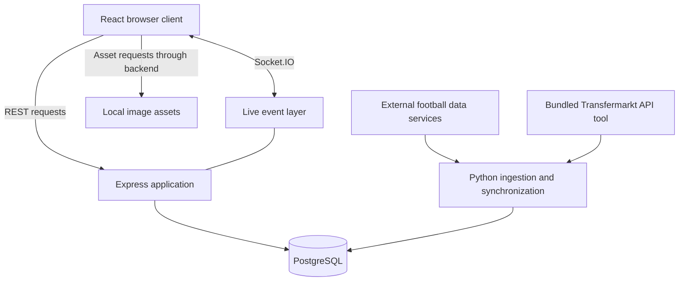

# XTR90 — Football Information and Analytics Platform

## Abstract

XTR90 (branded XTRA90 in the application) is a full-stack football information platform that brings match coverage, competition data, player and team profiles, transfers, news, and statistics into a single web interface. The project combines a React client, an Express API, a PostgreSQL data layer, and Python ingestion scripts. It provides a practical case study in integrating heterogeneous sports data, designing a relational domain model, and delivering frequently updated information through a web application.

This repository contains the application and supporting data workflows. It does not present a controlled research experiment or claim measured improvements over other platforms.

## 1. Problem Statement and Objectives

Football information is distributed across providers with different identifiers, update intervals, and levels of historical coverage. Presenting this information coherently requires normalization, synchronization, and a consistent interface.

The project's objectives are to:

- Consolidate fixtures, results, competitions, teams, and players in a relational data model.
- Support match exploration through statistics, events, and live update infrastructure.
- Provide transfer, ranking, and news views alongside core match information.
- Offer account management, favorites, and multilingual presentation.
- Separate presentation, application logic, persistence, and ingestion responsibilities.

## 2. Implemented Scope

| Area | Repository implementation |
| --- | --- |
| Match coverage | Fixtures, results, match details, and live synchronization scripts |
| Football entities | Countries, competitions, teams, and player modules |
| Analysis | Team form, competition tables, statistics, and rankings |
| Editorial and transfer data | News and transfer modules with enrichment workflows |
| User services | Authentication, profiles, favorites, and administrative routes |
| Internationalization | Client translation resources and localized request headers |
| Live delivery | Socket.IO subscriptions for live and individual match channels |
| Data integration | API-Football ingestion and Transfermarkt integration tooling |

Availability and completeness of individual views depend on the configured database and imported data.

## 3. System Architecture



The frontend uses React Router for navigation, Axios for API requests, and i18next for translation. The backend organizes domain functionality into modules and exposes its main REST routes under `/api/v1`. PostgreSQL stores application data and HTTP sessions. Python scripts support historical imports, enrichment, and recurring synchronization.

During local development, Vite proxies `/api`, `/assets`, and `/socket.io` to the backend on port `3000`.

### Technology Stack

| Layer | Technologies |
| --- | --- |
| Frontend | React 19, Vite 8, React Router, Axios, i18next, Tailwind CSS tooling |
| Backend | Node.js, Express 5, PostgreSQL client (`pg`), Socket.IO |
| Authentication | Express sessions, PostgreSQL session storage, Passport, bcrypt |
| Data workflows | Python, psycopg2, python-dotenv, SQL migrations, PowerShell utilities |
| Verification | Node.js test runner, Python unittest, Oxlint, locale validation scripts |

## 4. Repository Organization

```text
.
├── frontend/
│   ├── src/                    # Pages, components, API client, and translations
│   ├── scripts/                # Localization validation utilities
│   └── public/                 # Frontend static resources
├── myapp-backend/
│   ├── src/modules/            # Domain routes and application logic
│   ├── src/realtime/           # Live event delivery
│   ├── src/public/assets/      # Football image assets
│   ├── database/migrations/    # Numbered schema changes
│   ├── scripts/                # Import, synchronization, and maintenance tools
│   ├── tests/                  # JavaScript and Python tests
│   └── .env.example            # Environment configuration template
└── tools/transfermarkt-api/    # Bundled third-party integration tool
```

## 5. Local Setup and Reproducibility

### Prerequisites

- A Node.js release compatible with the versions in the package lockfiles.
- npm, Python 3, and PostgreSQL with the `psql` client.
- A compatible base football database schema and data where required.
- API credentials for the external ingestion workflows you intend to execute.

The repository includes a substantial collection of image assets, so the initial clone may take several minutes.

### Install Dependencies

```sh
git clone https://github.com/Sohaybherr/XTR90.git
cd XTR90
npm ci --prefix frontend
npm ci --prefix myapp-backend
python -m pip install -r myapp-backend/requirements.txt
```

Individual optional scripts may need additional packages. For example, `seed_database.py` also imports `faker`. The bundled Transfermarkt service has its own dependency configuration in `tools/transfermarkt-api/`.

### Configure the Backend

Copy `myapp-backend/.env.example` to `myapp-backend/.env` and replace the placeholders with local values.

| Variables | Purpose |
| --- | --- |
| `DB_HOST`, `DB_PORT`, `DB_NAME`, `DB_USER`, `DB_PASSWORD` | PostgreSQL connection settings |
| `SESSION_SECRET` | Session signing secret; replace the example value |
| `CLIENT_ORIGIN`, `CORS_ORIGIN` | Allowed frontend origins |
| `API_FOOTBALL_KEY`, `API_FOOTBALL_BASE_URL` | API-Football ingestion configuration |
| `TRANSFERMARKT_API_URL` | Transfermarkt integration endpoint |
| `GOOGLE_*`, `FACEBOOK_*` | Optional social authentication configuration |

The Node.js database configuration also accepts `DATABASE_URL`. Keep credentials in local environment configuration; `.env` files are excluded from version control.

### Prepare the Database

The SQL files in `myapp-backend/database/migrations/` are incremental migrations. The first migration alters existing tables such as `competitions`, `teams`, `players`, and `matches`; it is not a complete empty-database bootstrap. A standalone base-schema installation script has not been identified in this repository. A compatible base schema or database backup is therefore required before applying these migrations.

Review each migration and apply the required files in numeric order against a development database. A PowerShell helper is available, for example:

```powershell
cd myapp-backend
./scripts/apply_migration.ps1 -MigrationFile database/migrations/001_prepare_api_football.sql
```

This command applies one migration. Review data-changing and account-seeding migrations before running them. The example seed script generates synthetic records and is not a substitute for the base schema.

### Run the Application

Start the backend in one terminal:

```sh
cd myapp-backend
npm run dev
```

Start the frontend in another terminal:

```sh
cd frontend
npm run dev
```

The backend listens on `http://localhost:3000`. Open the frontend URL printed by Vite, normally `http://localhost:5173`. If Vite selects another port, update the configured allowed origins accordingly. `VITE_API_URL` can override the client's default `/api/v1` API base.

Starting the web servers does not automatically execute every ingestion job. Synchronization and backfill commands are defined separately in `myapp-backend/package.json`; select them according to the intended dataset and provider quota.

## 6. Verification and Evaluation

Run the backend test suite from `myapp-backend/`:

```sh
npm test
```

This runs Python unittest discovery followed by the JavaScript tests. JavaScript tests can also be run independently with `node --test tests/*.test.js`.

Run frontend checks from `frontend/`:

```sh
npm run lint
npm run lint:i18n
npm run lint:locale-ui
npm run build
```

The JavaScript suite covers areas including input validation, authorization, public DTOs, statistics calculations, provider identity mapping, and selected route behavior. These checks do not establish end-to-end correctness, production readiness, or the accuracy of upstream football data.

An academic evaluation could additionally measure synchronization latency, data completeness by competition and season, API response times under a defined workload, and task completion in a usability study. Such measurements are proposed evaluation criteria; no benchmark results are claimed here.

## 7. Limitations and Future Work

- **Database reproducibility:** a complete base-schema bootstrap and documented sample dataset are needed for installation from an empty database.
- **External dependencies:** provider availability, quotas, historical coverage, and schema changes affect ingestion results.
- **Data freshness:** live information depends on synchronization frequency and successful upstream requests.
- **Repository size:** the image collection increases clone and maintenance costs; separate asset hosting could be evaluated.
- **Validation scope:** broader integration tests, accessibility checks, and reproducible performance measurements remain useful extensions.
- **Deployment:** the current repository does not establish a complete production deployment procedure.

## 8. Data Provenance and Acknowledgments

Data workflows integrate API-Football and Transfermarkt-related services. Imported facts, news, photographs, logos, and other assets retain their respective provenance and ownership. Inclusion in this repository does not establish permission for every downstream use.

The bundled `tools/transfermarkt-api/` tool derives from Felipe Allegretti's Transfermarkt API project. Its [MIT license](tools/transfermarkt-api/LICENSE) is retained. That license applies to the bundled tool and should not be interpreted as a license for the entire application or its datasets. No root application license is currently provided.

## 9. Academic Use

For a report or demonstration, identify the exact commit, describe the database preparation, record the data retrieval period and enabled providers, and document which checks were executed. Distinguish synthetic seed data from imported observations and report missing coverage explicitly. Institutional affiliation, supervision, authorship details, and experimental results should be added only when verified by the project author.
